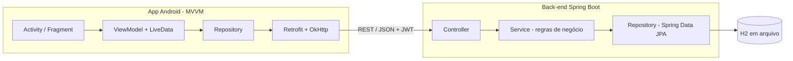

# Casa em Dia

Projeto final da disciplina **OTES06 – Desenvolvimento Mobile** da Universidade do Estado de Santa Catarina (UDESC), ministrada pelo Prof. Allan Rodrigo Leite.

**Casa em Dia** é um aplicativo Android para manter a casa em dia. Em um só lugar, o usuário controla **contas a pagar**, **manutenções**, **lembretes gerais** e a **lista de compras**, e acompanha os **gastos** mês a mês. Cada pessoa cria a sua conta, que representa a sua casa, e o app avisa quando há algo vencendo ou atrasado.

> 🎥 **Vídeo de demonstração:** [`otes-guia-video-final.mp4`](otes-guia-video-final.mp4), na raiz do repositório ([baixar o vídeo](https://github.com/Souza04Gustavo/tr-final-otes06/raw/main/otes-guia-video-final.mp4)). Como o arquivo é grande (≈ 51 MB), o GitHub não o reproduz na página: use o link de download ou o botão *View raw* e assista no player do computador.
>
> 💻 **Desenvolvido e testado no Windows 11** (PowerShell + Android Studio + emulador Android 17). O passo a passo com todos os comandos para executar está em [Como executar](#como-executar).

## Atendimento aos requisitos do trabalho

| Requisito | Como foi atendido |
|---|---|
| Aplicativo móvel ponta a ponta | App Android + API REST + banco de dados, com cadastro, login e dados persistidos por usuário |
| Front-end **Android nativo** | Java, Views XML, Material Components, arquitetura MVVM ([detalhes](docs/02-arquitetura.md#25-app-android)) |
| Back-end em **Java** | Java 21 + Spring Boot 4.1 ([detalhes](docs/02-arquitetura.md#23-back-end)) |
| Comunicação **REST** | 18 endpoints JSON com autenticação JWT ([contrato completo](docs/03-api.md)) |
| Organização do código e boas práticas | Camadas e pacotes por funcionalidade, DTOs, validação, erros padronizados e 46 testes automatizados (seção [Arquitetura e boas práticas](#arquitetura-e-boas-práticas)) |
| Documentação funcional e de build/execução | Este README ([como usar](#como-usar-o-app) e [como executar](#como-executar), com os comandos de cada passo) e a pasta [`docs/`](docs/) |
| Vídeo de demonstração | [`otes-guia-video-final.mp4`](otes-guia-video-final.mp4), na raiz do repositório (link também no topo desta página) |

## Funcionalidades

- **Conta de usuário:** cadastro e login; cada usuário vê somente os dados da própria casa.
- **Painel:** atrasados, o que vence hoje, os próximos 7 dias, itens a comprar e o resumo das contas do mês (total, pago e pendente).
- **Lembretes** nas categorias *Conta*, *Manutenção* e *Outro*:
  - recorrência semanal, mensal, anual ou **a cada N dias**;
  - ao concluir um lembrete recorrente, a próxima ocorrência é criada automaticamente, e um botão **"Desfazer"** reverte a conclusão;
  - manutenções podem ser pontuais (ex.: consertar a torneira) ou periódicas; nas periódicas, o intervalo conta a partir da data em que o serviço foi feito;
  - atrasados ficam destacados, com a quantidade de dias de atraso;
  - busca por título ou observação, sem diferenciar acentos e maiúsculas.
- **Análise de gastos:** total do mês, variação em relação ao mês anterior, média mensal, divisão por categoria, maiores gastos e gráfico dos últimos 6 meses (tocar em uma coluna abre aquele mês).
- **Lista de compras:** adicionar itens com quantidade, marcar como comprado, editar, excluir (com "Desfazer") e limpar os comprados.
- **Notificações:** aviso diário no celular quando há lembretes para hoje ou atrasados, mais a opção "Verificar lembretes agora" no menu.

## Como usar o app

| Tela | O que se faz nela |
|---|---|
| **Login / Cadastro** | Criar a conta (nome, nome da casa, e-mail e senha) ou entrar. A sessão continua ativa entre aberturas do app. |
| **Painel** (aba inicial) | Ver de relance os atrasados, o que vence hoje, as contas do mês e os próximos 7 dias. Tocar em "Contas do mês" abre a análise de gastos. |
| **Lembretes** | Filtrar por categoria e por pendentes ou concluídos, buscar por texto e concluir pela caixa à direita. O botão **+** cria um lembrete e tocar em um item abre a edição. |
| **Formulário de lembrete** | Título, categoria, data, valor (obrigatório para contas), repetição ("a cada N dias" para manutenções periódicas) e observação. |
| **Gastos** | Trocar de mês pelas setas ou tocando nas colunas do gráfico; ver total, pago, pendente, categorias e maiores gastos. |
| **Compras** | Adicionar um item com quantidade, marcar como comprado, segurar o dedo sobre o item para editar ou excluir, e "Limpar comprados". |
| **Menu ⋮** | "Verificar lembretes agora" (dispara a notificação na hora) e "Sair". |

As regras de negócio (recorrência, atraso, resumo do mês etc.) estão em [docs/01-especificacao.md](docs/01-especificacao.md#15-regras-de-negócio).

## Tecnologias

| Parte | Stack |
|---|---|
| App (front-end) | Android nativo em **Java**, Views XML + Material Components, MVVM (ViewModel + LiveData), Retrofit + OkHttp + Gson, Navigation Component, WorkManager |
| API (back-end) | **Java 21** + **Spring Boot 4.1**, Spring Web MVC, Spring Data JPA, Spring Security (JWT), Bean Validation, springdoc-openapi (Swagger) |
| Banco de dados | H2 em modo arquivo (não precisa instalar nada) |
| Comunicação | **API REST** com JSON e autenticação Bearer (JWT) |

## Arquitetura e boas práticas



**Back-end**
- Organização **por funcionalidade** (`auth`, `usuario`, `lembrete`, `compra`, `painel`, `analise`), cada uma com controller → service → repository.
- **DTOs** (`record`) na entrada e na saída; as entidades JPA nunca são expostas.
- **Bean Validation** nos dados de entrada e erros num **formato JSON único** (`GlobalExceptionHandler`): 400, 401, 404, 409, 422.
- **Segurança:** JWT *stateless*, senhas com BCrypt e isolamento total entre usuários (recurso de outro usuário responde 404).
- **Regras testáveis:** a data de "hoje" vem de um `Clock` injetado, e a recorrência fica isolada em `CalculadoraRecorrencia`.
- API documentada com **Swagger/OpenAPI**.

**App Android**
- **MVVM**: as telas só observam o `LiveData` do ViewModel; o ViewModel fala com os repositories, que encapsulam o Retrofit.
- Estado de carregamento, sucesso e erro padronizado (`Resource<T>`) e mensagens de uso único (`Evento<T>`), para não se repetirem ao girar a tela.
- Proteção contra envio duplicado (toques repetidos), expiração de sessão tratada no `AuthInterceptor` (401 → volta ao login) e textos em `strings.xml` com plurais.
- Identidade visual com cores e cantos em tokens, cores validadas para contraste e daltonismo ([docs/05-identidade-visual.md](docs/05-identidade-visual.md)).

**Testes automatizados (46)**
- **Back-end (30):** recorrência, regras dos lembretes (incluindo desfazer), painel, análise de gastos e testes de integração da API com MockMvc e H2 em memória.
- **App (16):** formatação de valores e datas em pt-BR e busca de lembretes.

## Estrutura do repositório

```
tr-final-otes06/
├── app/                  Módulo do aplicativo Android (código Java e layouts XML)
├── gradle/, gradlew      Gradle Wrapper e catálogo de versões do app
├── build.gradle.kts      Build do projeto Android (a raiz é o projeto do Android Studio)
├── settings.gradle.kts
├── backend/              API REST em Spring Boot (projeto Maven independente)
├── docs/                 Documentação do projeto
└── otes-guia-video-final.mp4   Vídeo de demonstração
```

## Documentação

| Documento | Conteúdo |
|---|---|
| [01 – Especificação funcional](docs/01-especificacao.md) | Escopo, requisitos, regras de negócio, telas |
| [02 – Arquitetura](docs/02-arquitetura.md) | Stack, camadas, pacotes, modelo de dados, segurança, testes, decisões |
| [03 – Contrato da API](docs/03-api.md) | Os 18 endpoints REST com exemplos |
| [04 – Plano de implementação](docs/04-plano-implementacao.md) | Etapas, cronograma e checklist de entrega |
| [05 – Identidade visual](docs/05-identidade-visual.md) | Cores, cantos, tipografia e padrão dos componentes |
| [06 – Roteiro do vídeo](docs/06-roteiro-video.md) | Plano da gravação da demonstração |

## Como executar

> 💻 **O projeto foi desenvolvido e testado no Windows 11**, e todos os comandos abaixo são para o **PowerShell** do Windows (Menu Iniciar › "PowerShell"). Quem usa Linux ou macOS encontra os equivalentes em [Comandos no Linux/macOS](#comandos-no-linuxmacos).

### Ambiente usado no desenvolvimento

| Item | Versão |
|---|---|
| Sistema operacional | Windows 11 Home, 64 bits |
| IDE | Android Studio (build AI-262), com o JDK 25 embutido (pasta `jbr`) |
| Android SDK | Android 17 (API 37) |
| Emulador | "Medium Phone", Android 17 (API 37) |
| Back-end | Java 21 (código-fonte), Maven 3.10 via *wrapper* `mvnw` |
| App | Gradle 9.6 + Android Gradle Plugin 9.5 via *wrapper* `gradlew` |

### Pré-requisitos

1. **Git**, para clonar o repositório.
2. **Android Studio** recente, com o **Android SDK 37** instalado (o Android Studio oferece instalar na primeira abertura do projeto) e um **emulador** criado em *Device Manager* (qualquer Android 8.0/API 26 ou superior; foi usado o "Medium Phone" com API 37).
3. **Java:** não é preciso instalar à parte. O **JDK que vem com o Android Studio** (versão 25) serve para o back-end e para o app.
4. **Conexão com a internet** na primeira execução: os *wrappers* baixam o Maven, o Gradle e as dependências sozinhos. O Maven e o Gradle **não** precisam estar instalados.

Se o Android Studio foi instalado em outra pasta, troque `C:\Program Files\Android\Android Studio` pelo caminho correto nos comandos abaixo. O SDK fica, por padrão, em `%LOCALAPPDATA%\Android\Sdk`.

### Passo 1. Baixar o código

```powershell
git clone https://github.com/Souza04Gustavo/tr-final-otes06.git
cd tr-final-otes06
```

### Passo 2. Configurar o Java no terminal

Rode isto **em cada janela do PowerShell** que for usar (a configuração vale só para aquela janela):

```powershell
$env:JAVA_HOME = "C:\Program Files\Android\Android Studio\jbr"
$env:ANDROID_HOME = "$env:LOCALAPPDATA\Android\Sdk"
$env:Path = "$env:JAVA_HOME\bin;$env:ANDROID_HOME\platform-tools;$env:ANDROID_HOME\emulator;$env:Path"
java -version    # deve mostrar a versão 21 ou superior
```

> Para não repetir em cada janela, dá para gravar a variável de forma permanente: `[Environment]::SetEnvironmentVariable("JAVA_HOME", "C:\Program Files\Android\Android Studio\jbr", "User")`. Depois feche e abra o PowerShell.

### Passo 3. Subir o back-end (terminal 1)

Na pasta do repositório:

```powershell
cd backend
.\mvnw.cmd spring-boot:run
```

- A primeira execução demora alguns minutos (download do Maven e das dependências).
- Está pronto quando o log mostra **`Started CasaEmDiaApplication`**. **Deixe esta janela aberta**, porque fechar o terminal desliga a API. Para parar, use `Ctrl + C`.
- A API fica em `http://localhost:8080`. Para abrir a documentação interativa (Swagger) no navegador:

```powershell
Start-Process "http://localhost:8080/swagger-ui.html"
```

O banco **H2** é criado sozinho em `backend\data\` na primeira execução, e não é preciso instalar banco de dados. Ele começa **vazio**: a conta de usuário é criada no app (passo 5) ou pelo comando opcional abaixo.

**Opcional: criar uma conta de teste pelo terminal** (em outro PowerShell, com o back-end rodando):

```powershell
$corpo = @{ nome = "Professor"; nomeCasa = "Casa de Teste"; email = "professor@teste.com"; senha = "segredo123" } | ConvertTo-Json
Invoke-RestMethod -Method Post -Uri "http://localhost:8080/api/auth/cadastro" -ContentType "application/json" -Body $corpo
```

Depois, entre no app com `professor@teste.com` / `segredo123`.

### Passo 4. Rodar o aplicativo Android

Com o back-end rodando, escolha **uma** das opções.

#### Opção A: pelo Android Studio (mais simples)

1. *File › Open* e selecione a **pasta raiz do repositório** (`tr-final-otes06`, e não a pasta `app` nem a `backend`).
2. Aguarde a sincronização do Gradle (barra inferior). Se o Android Studio pedir para instalar o SDK 37, aceite.
3. Em *Device Manager*, ligue um emulador (ou crie um: *Create Virtual Device* › "Medium Phone" › API 37).
4. Selecione a configuração **app** e clique em **Run ▶** (`Shift + F10`).

#### Opção B: pelo terminal (terminal 2)

Em um **novo** PowerShell, na pasta raiz do repositório, repita o **Passo 2** e depois:

```powershell
emulator -list-avds                                   # lista os emuladores criados
Start-Process emulator -ArgumentList "-avd", "Medium_Phone_API_37.0"   # use um nome da lista acima

adb wait-for-device                                   # espera o emulador ligar
do { Start-Sleep 3 } until ((adb shell getprop sys.boot_completed) -match "1")

.\gradlew.bat installDebug                            # compila e instala o app no emulador
adb shell am start -n br.udesc.casaemdia/.ui.auth.LoginActivity   # abre o app
```

Para só gerar o APK, sem instalar: `.\gradlew.bat assembleDebug` (o arquivo sai em `app\build\outputs\apk\debug\app-debug.apk`).

### Passo 5. Usar o app

1. Na primeira abertura, o app pede duas permissões. **Permita as duas:**
   - **Dispositivos por perto / rede local** (Android 17+): sem ela o sistema bloqueia o acesso ao back-end local.
   - **Notificações** (Android 13+): para os avisos de lembretes.

   Também é possível concedê-las pelo terminal (a de rede local só existe no Android 17):

   ```powershell
   adb shell pm grant br.udesc.casaemdia android.permission.POST_NOTIFICATIONS
   adb shell pm grant br.udesc.casaemdia android.permission.ACCESS_LOCAL_NETWORK
   ```

2. Toque em **Criar conta** e preencha nome, nome da casa, e-mail e senha (ou entre com a conta criada pelo terminal no passo 3).
3. Cadastre alguns lembretes (botão **+** na aba Lembretes) e itens de compra. A seção [Como usar o app](#como-usar-o-app) descreve cada tela.

O app acessa a API em `http://10.0.2.2:8080/`, que é o endereço do computador visto de dentro do emulador. Para usar um **celular físico**, altere `BASE_URL` em `app/build.gradle.kts` para o IP do computador na rede local (ex.: `http://192.168.0.10:8080/`, que aparece com o comando `ipconfig`) e libere esse IP em `app/src/main/res/xml/network_security_config.xml`.

### Passo 6. Rodar os testes automatizados

Com o Java configurado (passo 2), a partir da pasta raiz do repositório:

```powershell
cd backend
.\mvnw.cmd test               # back-end: 30 testes (usa um H2 em memória, não mexe nos dados)
cd ..
.\gradlew.bat testDebugUnitTest   # app: 16 testes
```

O resultado aparece no terminal (`BUILD SUCCESS` no Maven e `BUILD SUCCESSFUL` no Gradle). Os relatórios ficam em `backend\target\surefire-reports\` e `app\build\reports\tests\testDebugUnitTest\index.html`.

### Ver o banco de dados (opcional)

Com o back-end rodando, abra o console do H2:

```powershell
Start-Process "http://localhost:8080/h2-console"
```

Preencha **JDBC URL** `jdbc:h2:file:./data/casaemdia`, **User Name** `sa` e **Password** em branco, e clique em *Connect*. As tabelas são `usuarios`, `lembretes` e `itens_compra`. Para recomeçar do zero, pare o back-end e apague a pasta `backend\data\`.

Opcional: defina a variável de ambiente `JWT_SECRET` (mínimo de 32 caracteres) antes de subir o back-end para usar um segredo próprio na assinatura dos tokens: `$env:JWT_SECRET = "um-segredo-com-pelo-menos-32-caracteres"`.

### Comandos no Linux/macOS

O projeto foi feito no Windows, mas os *wrappers* também funcionam em Linux e macOS. Mudam só estes comandos:

| Windows (PowerShell) | Linux / macOS (bash/zsh) |
|---|---|
| `$env:JAVA_HOME = "C:\Program Files\Android\Android Studio\jbr"` | Linux: `export JAVA_HOME="<pasta do Android Studio>/jbr"` · macOS: `export JAVA_HOME="/Applications/Android Studio.app/Contents/jbr/Contents/Home"` |
| `$env:ANDROID_HOME = "$env:LOCALAPPDATA\Android\Sdk"` | Linux: `export ANDROID_HOME="$HOME/Android/Sdk"` · macOS: `export ANDROID_HOME="$HOME/Library/Android/sdk"` |
| `.\mvnw.cmd spring-boot:run` | `./mvnw spring-boot:run` |
| `.\gradlew.bat installDebug` | `./gradlew installDebug` |
| `Start-Process emulator -ArgumentList "-avd", "<nome>"` | `emulator -avd <nome> &` |

### Problemas comuns

| Sintoma | Causa e solução |
|---|---|
| O app mostra "Não foi possível conectar ao servidor" | O back-end não está rodando (veja o terminal 1) ou a permissão de **rede local** foi negada. Ative em Configurações › Apps › Casa em Dia › Permissões, ou use o comando `adb shell pm grant` do passo 5. |
| `.\mvnw.cmd` "não é reconhecido como nome de cmdlet" | O terminal não está na pasta `backend`. Rode `cd backend` antes. |
| `JAVA_HOME not found` / `java` não é reconhecido | O passo 2 não foi feito nesta janela do PowerShell, ou o Android Studio está em outra pasta. Ajuste o caminho do `JAVA_HOME`. |
| `Port 8080 was already in use` | Já existe um back-end rodando. Feche a outra janela ou encerre o processo: `Stop-Process -Id (Get-NetTCPConnection -LocalPort 8080 -State Listen).OwningProcess`. |
| `Database may be already in use` | Mesma causa: outra instância do back-end está usando o banco. Encerre-a como na linha acima. |
| `SDK location not found` ao rodar o `gradlew` | Falta o `ANDROID_HOME` (passo 2) ou o SDK não está instalado. Abrir o projeto uma vez no Android Studio também resolve, porque ele cria o `local.properties`. |
| `adb` ou `emulator` não é reconhecido | Faltou a linha do `$env:Path` do passo 2. |
| "System UI isn't responding" no emulador logo após ligar | Comum no primeiro boot do emulador. Toque em **Wait**. |
| Erro de `jlink` ao compilar pelo terminal | O Gradle escolheu um Java incompleto (por exemplo, o embutido em extensões do VS Code). Rode `.\gradlew.bat --stop` e depois `.\gradlew.bat installDebug "-Dorg.gradle.java.installations.auto-detect=false" "-Dorg.gradle.java.installations.paths=C:/Program Files/Android/Android Studio/jbr"`, ou compile pelo Android Studio. |
| A notificação não aparece | A permissão de notificações foi negada. Ative-a nas configurações do app e use o menu ⋮ › "Verificar lembretes agora". |

## Autor

Gustavo de Souza
