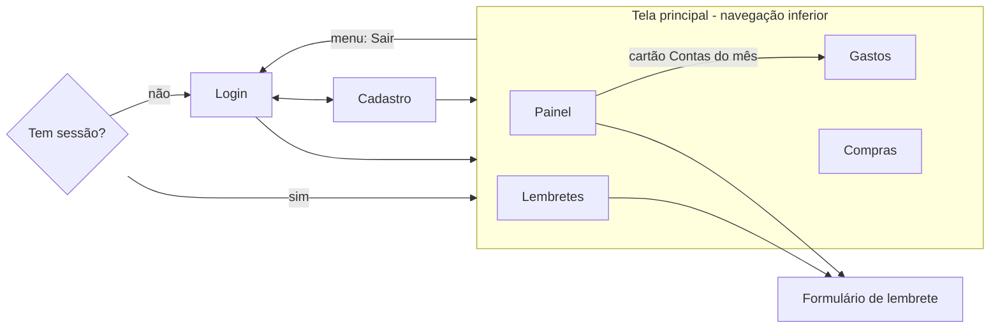

# 1. Especificação Funcional — Casa em Dia

> Documento de definição do MVP. Descreve **o que** o aplicativo faz.
> O **como** está em [02-arquitetura.md](02-arquitetura.md) e o contrato da API em [03-api.md](03-api.md).

## 1.1 Visão geral

**Casa em Dia** é um aplicativo Android para manter a casa em dia: contas a pagar, manutenções periódicas, lembretes gerais e a lista de compras, tudo em um só lugar.

Cada pessoa instala o app, cria a sua conta (que representa a **sua casa**) e gerencia os próprios dados. O back-end, em Java e Spring Boot, armazena as informações e aplica as regras de negócio: recorrência, atraso e resumo financeiro do mês. O app consome essas regras por uma API REST.

**Problema que resolve:** contas vencem sem ninguém perceber, a manutenção da casa é esquecida (o filtro de água, a dedetização, a revisão do ar-condicionado) e a lista de compras fica espalhada em papéis e conversas.

**Público-alvo:** qualquer pessoa responsável por uma casa ou apartamento, seja próprio ou alugado.

## 1.2 Módulos do MVP

| Módulo | O que faz |
|---|---|
| **Autenticação** | Cadastro, login e logout. Cada usuário enxerga apenas os próprios dados. |
| **Painel** (tela inicial) | Resume a situação da casa: atrasados, o que vence hoje, os próximos 7 dias, as contas do mês e os itens a comprar. |
| **Lembretes** | Contas, manutenções e outros compromissos, com data, valor opcional e recorrência. |
| **Lista de compras** | Itens com quantidade, que são marcados como comprados no mercado. |
| **Notificações** | Aviso diário no celular quando há lembretes para hoje ou atrasados. |
| **Análise de gastos** | Gráficos dos gastos do mês e dos meses anteriores: total, variação, divisão por categoria e maiores gastos. |

### Categorias de lembrete

| Categoria | Exemplos | Particularidade |
|---|---|---|
| `CONTA` | Luz, água, internet, aluguel, condomínio | **Valor obrigatório**; entra no resumo financeiro do mês |
| `MANUTENCAO` | Consertar torneira, trocar filtro de água, dedetização | Pode ser **pontual** (sem recorrência) ou **periódica** (normalmente "a cada N dias") |
| `OUTRO` | Renovar seguro, levar o lixo reciclável | — |

### Tipos de recorrência

| Recorrência | Próxima data, calculada ao concluir | Uso típico |
|---|---|---|
| `NENHUMA` | Não gera uma próxima ocorrência | Compromisso único |
| `SEMANAL` | data de vencimento + 7 dias | Lixo reciclável |
| `MENSAL` | data de vencimento + 1 mês | Contas mensais |
| `ANUAL` | data de vencimento + 1 ano | IPTU, seguro |
| `A_CADA_N_DIAS` | **data em que foi concluído** + N dias | **Manutenção periódica** |

> Por que `A_CADA_N_DIAS` conta a partir da **conclusão**? Na manutenção, o que importa é quando o serviço foi feito de fato. Se o filtro deveria ser trocado em 01/03 mas só foi trocado em 15/03, a próxima troca é 180 dias depois de 15/03. Já as contas têm dia fixo de vencimento, então as recorrências de calendário contam a partir da data de vencimento.

## 1.3 Requisitos funcionais

Prioridade: **E** = essencial (precisa estar no MVP); **D** = desejável (é a primeira coisa a cortar se faltar tempo).

| ID | Requisito | Prior. |
|---|---|---|
| RF01 | Cadastrar usuário informando nome, nome da casa, e-mail e senha. | E |
| RF02 | Fazer login com e-mail e senha. A sessão continua ativa entre aberturas do app até o logout ou a expiração do token. | E |
| RF03 | Sair da conta (logout). | E |
| RF04 | Criar lembrete com título, categoria, data de vencimento, valor, recorrência (com intervalo em dias, quando aplicável) e observação. | E |
| RF05 | Listar lembretes, filtrando por categoria e situação (pendentes ou concluídos), em ordem de data de vencimento. | E |
| RF06 | Editar lembrete. | E |
| RF07 | Excluir lembrete. | E |
| RF08 | Concluir lembrete. Se ele for recorrente, o sistema cria automaticamente a próxima ocorrência. | E |
| RF09 | Destacar visualmente os lembretes atrasados. | E |
| RF10 | Registrar manutenção, seja **pontual** (lembrete `MANUTENCAO` com recorrência `NENHUMA`, ex.: consertar a torneira) ou **periódica** (recorrência `A_CADA_N_DIAS`, em que a próxima data conta a partir da conclusão; ex.: trocar o filtro a cada 180 dias). | E |
| RF11 | Adicionar item à lista de compras, com nome e quantidade. | E |
| RF12 | Marcar e desmarcar um item como comprado. | E |
| RF13 | Excluir item da lista de compras. | E |
| RF14 | Limpar de uma vez todos os itens já comprados. | E |
| RF15 | Exibir o painel com: atrasados, vencendo hoje, próximos 7 dias, quantidade de itens a comprar e resumo das contas do mês (total, pago e pendente). | E |
| RF16 | Editar item da lista de compras (nome e quantidade). | D |
| RF17 | Notificação local diária quando houver lembretes vencendo hoje ou atrasados. | D |
| RF18 | Opção "Verificar lembretes agora", que dispara a verificação de notificação na hora (útil para a demonstração). | D |
| RF19 | Buscar lembretes por texto no título ou na observação, sem diferenciar maiúsculas e acentos. | D |
| RF20 | Desfazer a conclusão de um lembrete logo após concluí-lo (botão "Desfazer"). | D |
| RF21 | Desfazer a exclusão de um item da lista de compras (botão "Desfazer"). | D |
| RF22 | Exibir a análise de gastos de um mês: total, pago, pendente, variação em relação ao mês anterior, média mensal, distribuição por categoria e maiores gastos. | D |
| RF23 | Exibir o histórico de gastos dos últimos 6 meses em gráfico, permitindo navegar entre os meses. | D |

## 1.4 Requisitos não funcionais

| ID | Requisito | Origem |
|---|---|---|
| RNF01 | Front-end em **Android nativo**, escrito em **Java**. | Enunciado |
| RNF02 | Back-end em **Java** (Spring Boot). | Enunciado |
| RNF03 | Comunicação front e back pelo padrão **REST** com JSON. | Enunciado |
| RNF04 | Código organizado em camadas, seguindo boas práticas. | Enunciado |
| RNF05 | Documentação funcional e de build/execução no repositório. | Enunciado |
| RNF06 | Autenticação *stateless* com **JWT**; senhas armazenadas com **BCrypt**. | Equipe |
| RNF07 | Isolamento de dados: um usuário nunca acessa dados de outro. | Equipe |
| RNF08 | API documentada com **OpenAPI/Swagger**. | Equipe |
| RNF09 | Validação de entrada e respostas de erro em formato padronizado. | Equipe |
| RNF10 | Back-end executável sem instalar banco de dados (**H2 em arquivo**). | Equipe |
| RNF11 | App compatível com Android 8.0 (API 26) ou superior. | Equipe |
| RNF12 | Testes unitários cobrindo as regras de negócio de recorrência e painel. | Equipe |

## 1.5 Regras de negócio

| ID | Regra |
|---|---|
| RN01 | Todo lembrete e todo item de compra pertence a um único usuário. As consultas sempre filtram pelo usuário autenticado. Recurso de outro usuário é tratado como **inexistente** (HTTP 404). |
| RN02 | O e-mail é único no sistema. A senha precisa ter no mínimo 6 caracteres. |
| RN03 | Lembrete da categoria `CONTA` exige `valor` maior que zero. Nas demais categorias o valor é opcional, mas, quando informado, também precisa ser maior que zero. |
| RN04 | A recorrência `A_CADA_N_DIAS` exige `intervaloDias` entre 1 e 3650. Nas demais recorrências, `intervaloDias` é ignorado e gravado como nulo. |
| RN05 | **Concluir** marca `concluido = true` e `dataConclusao = hoje`. Se a recorrência não for `NENHUMA`, o sistema cria um novo lembrete pendente com os mesmos dados e a nova data, calculada conforme a tabela de recorrências (seção 1.2). |
| RN06 | Não é possível concluir um lembrete que já está concluído (HTTP 422). |
| RN07 | **Atrasado** é o lembrete não concluído com `dataVencimento < hoje`. A informação é calculada a cada consulta e não fica gravada no banco. |
| RN08 | **Resumo do mês**: considera os lembretes `CONTA` com vencimento no mês corrente. *Total* é a soma de todos; *pago* é a soma dos concluídos; *pendente* é a soma dos não concluídos. |
| RN09 | **Painel**: *atrasados* são os pendentes com vencimento antes de hoje; *hoje* são os pendentes com vencimento igual a hoje; *próximos 7 dias* são os pendentes com vencimento entre amanhã e hoje + 7. |
| RN10 | Item de compra: nome obrigatório (até 80 caracteres) e quantidade inteira ≥ 1 (padrão 1). |
| RN11 | **Limpar comprados** exclui todos os itens marcados como comprados do usuário. |
| RN12 | Na recorrência `MENSAL`, quando o dia não existe no mês seguinte, o Java ajusta para o último dia do mês (31/01 → 28/02). A ocorrência seguinte parte da nova data (28/02 → 28/03). Essa é uma limitação conhecida e aceita no MVP. |
| RN13 | "Hoje" é sempre calculado no fuso `America/Sao_Paulo`. |
| RN14 | **Análise de gastos**: considera todo lembrete com valor, de qualquer categoria, no mês do seu vencimento. *Pago* é a soma dos concluídos; *pendente*, a dos não concluídos. |
| RN15 | O histórico tem de 2 a 12 meses (padrão 6) e termina no mês analisado. A *média mensal* considera só os meses que tiveram algum gasto. |
| RN16 | A *variação* compara o total do mês com o do mês anterior, em %. Se o mês anterior não teve gasto, não há variação. |
| RN17 | *Maiores gastos* somam os lembretes de mesmo título (sem diferenciar maiúsculas e espaços extras), do maior para o menor; a partir do 6º título, o restante é agrupado em "Outros". |
| RN18 | **Desfazer a conclusão** volta o lembrete para pendente e remove a ocorrência que a conclusão gerou, se ela ainda estiver pendente. Só é possível em lembrete concluído (HTTP 422 caso contrário). |

## 1.6 Telas e navegação



| # | Tela | Conteúdo e ações |
|---|---|---|
| T1 | **Login** | E-mail, senha, botão "Entrar" e link "Criar conta". |
| T2 | **Cadastro** | Nome, nome da casa, e-mail, senha e botão "Cadastrar" (entra direto no app). |
| T3 | **Painel** | Saudação com o nome da casa. Cartões: *Atrasados (n)*, *Hoje (n)*, *Contas do mês* (total, pago e pendente) e *Itens a comprar (n)*. Abaixo, a lista dos próximos 7 dias. Tocar em um lembrete abre o formulário. Atualiza ao puxar a tela para baixo. |
| T4 | **Lembretes** | Campo de busca (título ou observação), chips de categoria (Todos, Contas, Manutenção, Outros) e alternância entre *Pendentes* e *Concluídos*. Cada item mostra um filete na cor da categoria, título, o nome da categoria, data, recorrência, valor e o status em texto (**"Atrasado há N dias"** em vermelho, **"Vence hoje"**). Botão ✔ para concluir (com "Desfazer" no aviso); tocar abre a edição; botão flutuante "+" cria um novo. |
| T5 | **Formulário de lembrete** | Título, categoria, data (DatePicker), valor, recorrência e "a cada N dias" (visível só em `A_CADA_N_DIAS`), além de observação. Botões Salvar e Excluir (este só na edição). |
| T6 | **Compras** | Campo de nome, campo de quantidade e botão "Adicionar" no topo. A lista mostra os itens pendentes primeiro; os comprados aparecem riscados no final. Checkbox para marcar; toque longo para editar ou excluir (com "Desfazer" no aviso); menu "Limpar comprados". |
| T7 | **Gastos** | Setas para trocar de mês. Resumo: total do mês, variação em relação ao mês anterior (▲ vermelho / ▼ verde), barra de quanto já foi pago, pago, pendente e média mensal. Cartões *Por categoria* (barra dividida + lista com valor e %), *Maiores gastos* (barras horizontais em ordem) e *Últimos 6 meses* (colunas com o mês escolhido em destaque; tocar em uma coluna abre aquele mês). |
| — | **Menu superior** | "Verificar lembretes agora" (RF18) e "Sair". |

Esboço do Painel:

```
┌──────────────────────────────────┐
│ Casa da Família Souza        ⋮  │
├──────────────────────────────────┤
│ ┌──────────┐ ┌──────────┐        │
│ │ Atrasados│ │   Hoje   │        │
│ │    2     │ │    1     │        │
│ └──────────┘ └──────────┘        │
│ ┌──────────────────────────────┐ │
│ │ Contas de novembro           │ │
│ │ Total R$ 820 · Pago R$ 500   │ │
│ │ Pendente R$ 320              │ │
│ └──────────────────────────────┘ │
│ ┌──────────────────────────────┐ │
│ │ 🛒 5 itens a comprar          │ │
│ └──────────────────────────────┘ │
│ Próximos 7 dias                  │
│  💰 Internet     28/11  R$ 99,90  │
│  🔧 Filtro água  01/12            │
├──────────────────────────────────┤
│ Painel  Lembretes  Gastos  Compras│
└──────────────────────────────────┘
```

## 1.7 Fora do escopo do MVP

Ficam registrados como trabalhos futuros:

- Casa compartilhada entre vários moradores, com convite e responsável por tarefa.
- Recuperação de senha, *refresh token* e troca de e-mail.
- Fotos e anexos (comprovantes de pagamento, notas fiscais).
- Modo offline com sincronização.
- Notificação *push* enviada pelo servidor (Firebase Cloud Messaging).
- Deploy do back-end em nuvem.
