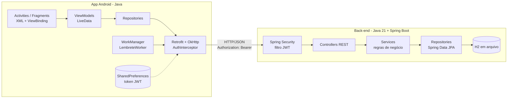
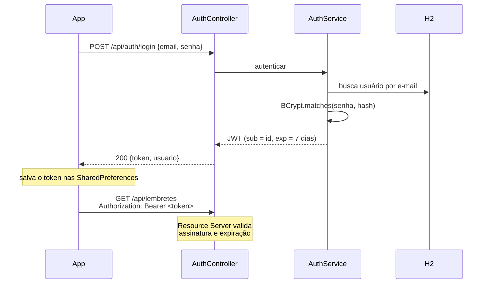
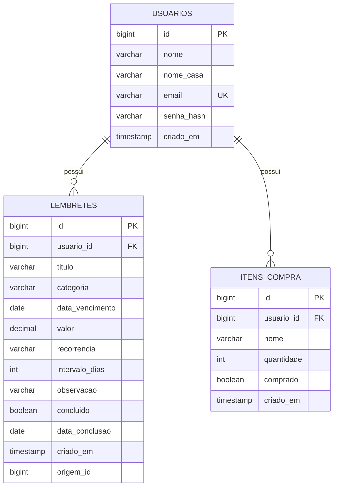
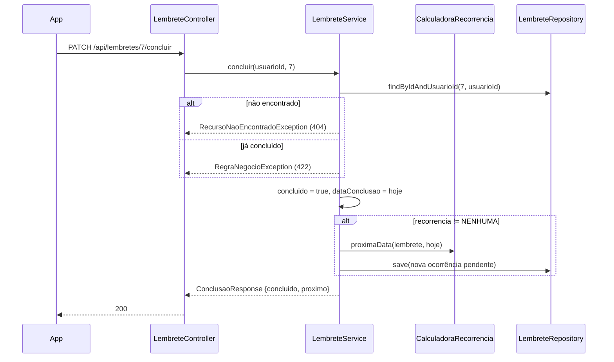
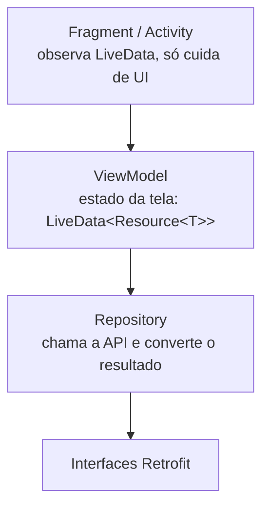
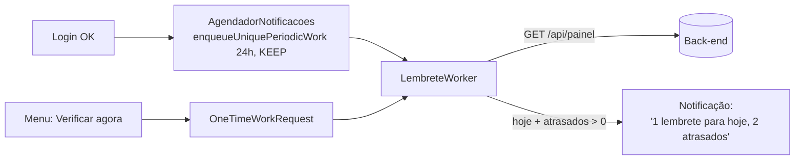

# 2. Arquitetura — Casa em Dia

> Define **como** o sistema é construído. Os requisitos estão em [01-especificacao.md](01-especificacao.md) e o contrato REST em [03-api.md](03-api.md).

## 2.1 Visão geral



São dois projetos independentes no mesmo repositório. A raiz é o projeto do Android Studio (Gradle), e o back-end é um projeto Maven isolado na subpasta `backend/`:

```
tr-final-otes06/
├── app/           → módulo do app Android (Gradle)
├── build.gradle.kts, settings.gradle.kts, gradle/, gradlew
├── backend/       → API REST (Maven, Spring Boot)
└── docs/          → esta documentação
```

## 2.2 Stack tecnológica

| Camada | Tecnologia | Motivo |
|---|---|---|
| Linguagem do back-end | Java 21 (LTS) | Exigência do enunciado; versão LTS com *records* |
| Framework | Spring Boot 4.1.x (Spring Framework 7, Hibernate 7, Jackson 3) | Padrão de mercado para APIs REST em Java; versão estável com suporte ativo |
| Build do back-end | Maven (com wrapper `mvnw`) | Quem avalia não precisa instalar o Maven |
| Persistência | Spring Data JPA + Hibernate | Repositórios sem SQL manual |
| Banco | H2 em modo arquivo | Dispensa instalação; os dados sobrevivem a reinícios |
| Segurança | Spring Security + OAuth2 Resource Server (JWT HS256) + BCrypt | Validação de JWT nativa do Spring, sem biblioteca externa |
| Validação | Jakarta Bean Validation (`@Valid`) | Validação declarativa nos DTOs |
| Documentação da API | springdoc-openapi 3.1 (Swagger UI) | API navegável e testável no navegador |
| Testes do back-end | JUnit + Mockito + AssertJ + MockMvc | Testes unitários das regras e teste de integração da API inteira |
| Linguagem do app | Java 17 (sintaxe), minSdk 26 | Exigência de Java; a API 26 traz `java.time` nativo |
| UI | Views XML + Material Components + ViewBinding | O Jetpack Compose exige Kotlin |
| Arquitetura do app | MVVM (ViewModel + LiveData) | Padrão recomendado pelo Android (Guide to App Architecture) |
| Navegação | Navigation Component + BottomNavigationView | Quatro abas (Painel, Lembretes, Gastos, Compras) com uma única Activity principal |
| Rede | Retrofit 3 + OkHttp 5 + Gson | Cliente REST mais usado no Android |
| Tarefas em segundo plano | WorkManager | Agenda a verificação diária para as notificações |
| Build do app | Gradle (Kotlin DSL, padrão do Android Studio) + version catalog | Os scripts de build ficam em `.kts`; **todo o código do app é Java** |

## 2.3 Back-end

### 2.3.1 Camadas

```
Controller  →  recebe HTTP, valida o DTO (@Valid), extrai o usuário do JWT e delega
Service     →  regras de negócio (recorrência, atraso, resumo) e transações
Repository  →  acesso a dados (Spring Data JPA), sempre filtrando por usuário
Entity      →  mapeamento JPA; nunca exposta diretamente na API
DTO         →  records de entrada (Request) e saída (Response)
```

### 2.3.2 Pacotes (organização por funcionalidade)

```
backend/src/main/java/br/udesc/casaemdia/
├── CasaEmDiaApplication.java
├── config/
│   ├── SecurityConfig.java          # filtros, rotas públicas, JwtEncoder/Decoder, BCrypt
│   ├── OpenApiConfig.java           # título da API + esquema "Bearer" no Swagger
│   └── ClockConfig.java             # bean Clock (America/Sao_Paulo)
├── auth/
│   ├── AuthController.java          # POST /api/auth/cadastro, /api/auth/login
│   ├── AuthService.java
│   ├── TokenService.java            # gera o JWT (subject = id do usuário)
│   └── dto/  CadastroRequest, LoginRequest, AuthResponse
├── usuario/
│   ├── Usuario.java                 # @Entity
│   ├── UsuarioRepository.java
│   ├── UsuarioController.java       # GET /api/usuarios/me
│   └── dto/  UsuarioResponse
├── lembrete/
│   ├── Lembrete.java                # @Entity
│   ├── Categoria.java               # enum CONTA, MANUTENCAO, OUTRO
│   ├── Recorrencia.java             # enum NENHUMA, SEMANAL, MENSAL, ANUAL, A_CADA_N_DIAS
│   ├── CalculadoraRecorrencia.java  # regra pura: calcula a próxima data (RN05)
│   ├── LembreteRepository.java
│   ├── LembreteService.java
│   ├── LembreteController.java
│   └── dto/  LembreteRequest, LembreteResponse, ConclusaoResponse
├── compra/
│   ├── ItemCompra.java              # @Entity
│   ├── ItemCompraRepository.java
│   ├── ItemCompraService.java
│   ├── ItemCompraController.java
│   └── dto/  ItemCompraRequest, ItemCompraResponse
├── painel/
│   ├── PainelService.java           # agrega dados de lembrete + compra (RN08, RN09)
│   ├── PainelController.java
│   └── dto/  PainelResponse, ResumoMesResponse
├── analise/
│   ├── AnaliseService.java          # totais, variação, média, por categoria, maiores gastos (RN14–RN17)
│   ├── AnaliseController.java       # GET /api/analises/gastos
│   └── dto/  AnaliseGastosResponse, GastoMensalResponse, GastoCategoriaResponse, MaiorGastoResponse
└── common/
    ├── security/UsuarioLogado.java  # helper: lê o id do usuário do Jwt
    └── exception/
        ├── RecursoNaoEncontradoException.java   # → 404
        ├── RegraNegocioException.java           # → 422
        ├── EmailJaCadastradoException.java      # → 409
        ├── ErroResponse.java                    # formato padrão de erro
        └── GlobalExceptionHandler.java          # @RestControllerAdvice
```

A organização é por **funcionalidade** e não por tipo (não há uma pasta `controllers/` com tudo misturado). Cada módulo fica coeso, e para entender "lembrete" basta abrir uma pasta.

### 2.3.3 Segurança e autenticação



- **Rotas públicas:** `/api/auth/**`, `/swagger-ui/**`, `/v3/api-docs/**`, `/h2-console/**` (este último só para desenvolvimento).
- **Todas as demais exigem o JWT.** Sem token ou com token inválido, a resposta é `401`.
- Sessão **STATELESS** e CSRF desabilitado, pois a API não usa cookies.
- JWT assinado com **HS256**, com segredo vindo de `app.jwt.secret` (que pode ser sobrescrito pela variável de ambiente `JWT_SECRET`) e validade de 7 dias.
- O controller obtém o usuário por `@AuthenticationPrincipal Jwt jwt` → `Long.valueOf(jwt.getSubject())`. **O id do usuário nunca vem do corpo da requisição nem da URL.**
- Isolamento (RN01): todo método de repositório recebe o `usuarioId`, como em `findByIdAndUsuarioId(...)`. Se o recurso não existe para aquele usuário, a API responde 404.

### 2.3.4 Tratamento de erros

Um `@RestControllerAdvice` converte as exceções no formato padrão descrito em [03-api.md](03-api.md#33-formato-de-erro):

| Exceção | HTTP |
|---|---|
| `MethodArgumentNotValidException` (falha no `@Valid`) | 400, com lista de campos |
| `HttpMessageNotReadableException` (JSON ou enum inválido) | 400 |
| Falha de credenciais no login | 401 |
| `RecursoNaoEncontradoException` | 404 |
| `EmailJaCadastradoException` | 409 |
| `RegraNegocioException` | 422 |
| Qualquer outra | 500 (mensagem genérica; detalhes só no log) |

### 2.3.5 Data e hora testáveis

Os services recebem um `java.time.Clock` por injeção e usam `LocalDate.now(clock)`. Em produção, o bean é `Clock.system(ZoneId.of("America/Sao_Paulo"))`; nos testes, `Clock.fixed(...)`. Isso torna determinísticas as regras de atraso, painel e recorrência.

### 2.3.6 Configuração (`application.properties`)

```properties
spring.datasource.url=jdbc:h2:file:./data/casaemdia
spring.jpa.hibernate.ddl-auto=update
spring.jpa.open-in-view=false
spring.h2.console.enabled=true
app.jwt.secret=${JWT_SECRET:<segredo-de-desenvolvimento-com-32+-caracteres>}
app.jwt.expiracao-horas=168
server.port=8080
```

### 2.3.7 Testes

| Teste | Tipo | O que cobre |
|---|---|---|
| `CalculadoraRecorrenciaTest` | Unitário puro | As 5 recorrências, incluindo o caso 31/01 → 28/02 e o `A_CADA_N_DIAS` contado da conclusão |
| `LembreteServiceTest` | Unitário (Mockito) | Concluir gera a próxima ocorrência; concluir duas vezes gera 422; `CONTA` sem valor gera 422; desfazer a conclusão remove a ocorrência gerada |
| `AnaliseServiceTest` | Unitário (Mockito + Clock fixo) | Totais, variação, % por categoria, histórico com meses vazios, média, ranking com "Outros" e limite de 12 meses |
| `PainelServiceTest` | Unitário (Mockito + Clock fixo) | Classificação em atrasados, hoje e próximos 7 dias; somas do resumo do mês |
| `ApiIntegrationTest` | Integração (`@SpringBootTest` + MockMvc + H2 em memória) | 401 sem token, cadastro/login, 400/409/422, ciclo criar→concluir→próxima ocorrência, isolamento entre usuários, desfazer conclusão, compras, painel e análise de gastos (incluindo `mes` inválido → 400) |

## 2.4 Modelo de dados



| Tabela.coluna | Tipo Java | Restrições |
|---|---|---|
| `usuarios.nome` | `String` | não nulo, até 100 caracteres |
| `usuarios.nome_casa` | `String` | não nulo, até 100 caracteres |
| `usuarios.email` | `String` | não nulo, **único**, até 150 caracteres, gravado em minúsculas |
| `usuarios.senha_hash` | `String` | não nulo (BCrypt) |
| `lembretes.titulo` | `String` | não nulo, até 100 caracteres |
| `lembretes.categoria` | `Categoria` (`@Enumerated(STRING)`) | não nulo |
| `lembretes.data_vencimento` | `LocalDate` | não nulo |
| `lembretes.valor` | `BigDecimal` (12,2) | nulo permitido (obrigatório para `CONTA`) |
| `lembretes.recorrencia` | `Recorrencia` (`@Enumerated(STRING)`) | não nulo, padrão `NENHUMA` |
| `lembretes.intervalo_dias` | `Integer` | nulo, exceto em `A_CADA_N_DIAS` |
| `lembretes.observacao` | `String` | até 500 caracteres |
| `lembretes.concluido` | `boolean` | padrão `false` |
| `lembretes.data_conclusao` | `LocalDate` | preenchida ao concluir |
| `lembretes.origem_id` | `Long` | id do lembrete cuja conclusão gerou esta ocorrência (usado para desfazer a conclusão) |
| `itens_compra.nome` | `String` | não nulo, até 80 caracteres |
| `itens_compra.quantidade` | `int` | ≥ 1 |
| `itens_compra.comprado` | `boolean` | padrão `false` |

Índices: `lembretes(usuario_id, concluido, data_vencimento)` e `itens_compra(usuario_id)`.

### Fluxo principal: concluir um lembrete recorrente



## 2.5 App Android

### 2.5.1 Arquitetura MVVM



- `Resource<T>` encapsula os estados `CARREGANDO`, `SUCESSO(dados)` e `ERRO(mensagem)`. A tela mostra o progresso, os dados ou uma Snackbar com o erro.
- Mensagens de uso único (avisos, "item adicionado") são entregues como `Evento<T>`, consumido uma única vez, para não reaparecerem ao girar a tela.
- A mensagem de erro vem do campo `mensagem` do `ErroResponse` do back-end. Para falha de rede, o app mostra "Não foi possível conectar ao servidor".

### 2.5.2 Pacotes

```
app/src/main/java/br/udesc/casaemdia/
├── CasaEmDiaApp.java                # Application: inicializa ApiClient e o canal de notificações
├── data/
│   ├── api/
│   │   ├── ApiClient.java           # configuração única do Retrofit (BASE_URL via BuildConfig)
│   │   ├── AuthInterceptor.java     # adiciona o Bearer; em 401, encerra a sessão
│   │   ├── ErrosApi.java            # lê o ErroResponse e monta a mensagem para o usuário
│   │   ├── LocalDateAdapter.java    # Gson ↔ "yyyy-MM-dd"
│   │   ├── LocalDateTimeAdapter.java
│   │   └── AuthApi, LembreteApi, CompraApi, PainelApi, AnaliseApi   # interfaces Retrofit
│   ├── model/                       # DTOs espelhando a API (LembreteDto, ItemCompraDto, ...)
│   ├── repository/                  # Auth/Lembrete/Compra/Painel/AnaliseRepository + CallbackApi, ResultadoCallback
│   └── session/SessionManager.java  # token + dados do usuário (SharedPreferences)
├── ui/
│   ├── AutenticadaActivity.java     # base das telas logadas: volta ao login sem sessão ou em 401
│   ├── Rotulos.java                 # textos dos enums (recorrência)
│   ├── Avisos.java                  # Snackbar com o botão "Desfazer"
│   ├── auth/       LoginActivity, CadastroActivity, AuthViewModel, ValidacaoCampos
│   ├── main/       MainActivity (BottomNavigationView + NavHostFragment), TelaPrincipal
│   ├── painel/     PainelFragment, PainelViewModel
│   ├── lembretes/  LembretesFragment, LembretesViewModel, LembreteAdapter, EstiloCategoria,
│   │               LembreteFormActivity, LembreteFormViewModel
│   ├── gastos/     GastosFragment, GastosViewModel, GraficoMensalView, BarraSegmentadaView
│   └── compras/    ComprasFragment, ComprasViewModel, ItemCompraAdapter
├── notificacao/
│   ├── LembreteWorker.java          # consulta /api/painel e notifica
│   ├── NotificacaoHelper.java       # canal + montagem da notificação
│   └── AgendadorNotificacoes.java   # agenda o PeriodicWorkRequest (diário, ~8h)
└── util/   Resource, Evento, Aviso, Busca, Formatadores (R$, datas), Janelas (edge-to-edge), Permissoes
```

O formulário de lembrete é uma **Activity** separada (`LembreteFormActivity`), aberta tanto pelo Painel quanto pela aba Lembretes. Ao voltar, as abas recarregam os dados no `onResume`.

### 2.5.3 Rede e sessão

- `BASE_URL` definida no `app/build.gradle.kts` com `buildConfigField`, padrão `http://10.0.2.2:8080/` (o endereço do PC visto pelo emulador).
- Como a URL é HTTP local, o `network_security_config.xml` libera *cleartext* **apenas** para `10.0.2.2` e `localhost`.
- `SessionManager` guarda o token, o nome e o nome da casa. A `LoginActivity` funciona como entrada do app: se já existe sessão, ela abre a `MainActivity` direto.
- O `AuthInterceptor` adiciona `Authorization: Bearer <token>`. Se a API responder `401` em uma rota autenticada (token expirado), ele limpa a sessão e o app volta para o Login.
- **Permissão de rede local (Android 17 / API 37):** a partir do Android 17, apps que miram a API 37 precisam da permissão `ACCESS_LOCAL_NETWORK` (grupo "Dispositivos por perto") para acessar endereços privados como `10.0.2.2` ou `192.168.x.x`. Sem ela, o sistema descarta as conexões e o app recebe só um *timeout*. Por isso o app declara a permissão e a pede no Login e na tela principal (`util/Permissoes`).
- Os ViewModels ignoram uma nova requisição de login, salvar ou excluir enquanto a anterior está em andamento, evitando envios duplicados por toque duplo.

### 2.5.4 Notificações



- O canal de notificação é criado ao iniciar o app.
- No Android 13 ou superior, a permissão `POST_NOTIFICATIONS` é pedida ao abrir a `MainActivity`, junto com a de rede local.
- Na verificação manual, se não houver nada pendente, o app avisa "Tudo em dia!", para dar retorno ao usuário.
- O worker só roda com rede disponível (`Constraints.NetworkType.CONNECTED`) e não faz nada se não houver sessão.
- No logout, o trabalho agendado é cancelado.

### 2.5.5 Gráficos, busca e "Desfazer"

- **Gráficos** desenhados com `Canvas` em duas *Views* próprias (D13):
  - `GraficoMensalView`: colunas do histórico, com o mês analisado na cor primária e os demais em cinza-azulado; o valor aparece só no mês em destaque, e tocar numa coluna abre aquele mês;
  - `BarraSegmentadaView`: barra fina dividida por categoria, com vão de 2 dp entre as partes.
  - Os maiores gastos usam `LinearProgressIndicator` (barras horizontais numa só cor). Todos os números também aparecem em texto e nas descrições de acessibilidade.
- **Busca** feita no `LembretesViewModel`, sobre a lista já carregada (`util/Busca` remove acentos e ignora maiúsculas).
- **"Desfazer"**: o ViewModel publica um `Aviso` (texto + ação opcional) e `ui/Avisos` mostra a Snackbar acima da navegação inferior. Para lembretes, a ação chama `PATCH /api/lembretes/{id}/reabrir`; para compras, recria o item com o mesmo nome, quantidade e situação.

## 2.6 Decisões de arquitetura

| # | Decisão | Alternativa descartada | Justificativa |
|---|---|---|---|
| D1 | Manutenção é uma **categoria** do lembrete: pontual (`NENHUMA`) ou periódica (`A_CADA_N_DIAS`) | Entidade `Manutencao` separada | Evita duplicar CRUD e telas; a única diferença real da periódica, contar a partir da conclusão, cabe na `CalculadoraRecorrencia`. |
| D2 | Lista de compras como entidade própria (`ItemCompra`) | Lembretes da categoria "COMPRA" | Itens de compra não têm data nem recorrência; o uso é marcar e limpar, que é outra interação. |
| D3 | H2 em arquivo | PostgreSQL via Docker | Build e execução com um único comando para quem avalia. Trocar para PostgreSQL depois exige só mudar dependência e `application.properties`. |
| D4 | JWT com Spring OAuth2 Resource Server | Filtro JWT manual com a biblioteca jjwt | Menos código próprio de segurança, que é onde bugs são mais caros. |
| D5 | Views XML no Android | Jetpack Compose | O Compose exige Kotlin, e o requisito é Java. |
| D6 | "Atrasado" calculado, não armazenado | Coluna `status` atualizada por *job* | Sem *job* agendado no servidor e sem dado que fica desatualizado. |
| D7 | Recurso de outro usuário responde **404** | 403 | Não revela a existência de ids de outros usuários. |
| D8 | Notificação local (WorkManager) | Push via Firebase (FCM) | Dispensa infraestrutura e conta no Firebase, e atende o caso de uso. |
| D9 | `Clock` injetado nos services | `LocalDate.now()` direto | Permite testar as regras de data de forma determinística. |
| D10 | DTOs como `record` e entidades nunca expostas | Retornar a entidade JPA | Desacopla a API do banco e evita vazar `senhaHash` e relações *lazy*. |
| D11 | Formulário de lembrete como Activity própria | Fragment no grafo de navegação | Recebe o id por `Intent` e é aberto de duas abas diferentes sem acoplar o grafo de navegação. |
| D12 | Log HTTP em nível `BASIC` (só em debug) | Nível `BODY` | Mostra método, URL, status e tempo sem expor senhas e tokens no logcat. |
| D13 | Gráficos desenhados com `Canvas` em *Views* próprias | Biblioteca de gráficos (ex.: MPAndroidChart) | São só dois gráficos simples; evita dependência externa (repositório JitPack) e dá controle total do visual. |
| D14 | Cálculos da análise de gastos no back-end | Calcular no app a partir da lista de lembretes | Uma única requisição traz tudo pronto, as regras ficam testadas em um só lugar e o app não precisa baixar o histórico inteiro. |
| D15 | "Desfazer conclusão" com rota `reabrir` e coluna `origem_id` | Adiar a chamada à API até a Snackbar sumir | A conclusão é gravada na hora (não se perde se o app fechar) e o servidor sabe exatamente qual ocorrência remover. |
| D16 | Busca de lembretes feita no app, sobre a lista já carregada | Parâmetro de busca na API | Responde a cada letra digitada sem novas requisições; a lista de um usuário é pequena. |
| D17 | Cor de `OUTRO` trocada de roxo para verde-azulado | Manter as cores dos mockups | O roxo ficava quase igual ao azul de `CONTA` (ΔE 7,8 em visão normal e 3,2 com deuteranopia). As três cores atuais passam na validação de daltonismo e contraste. |
| D18 | Identidade visual própria em azul-anil, com cantos de 2/4/6 dp e cores como tokens por função ([04-identidade-visual.md](04-identidade-visual.md)) | Verde e cantos arredondados dos mockups iniciais / tema Material padrão | Visual mais sóbrio e coerente; nomes por função (`primaria`, `pendente`) permitem trocar a paleta sem mexer nos layouts. Os mockups iniciais ficaram como referência de layout, não de cor. |

### Testes do app

| Teste | Tipo | O que cobre |
|---|---|---|
| `FormatadoresTest` | Unitário (JVM) | Leitura de valores digitados ("184,50", "1.234,50", "R$ 99,90"), formatação de moeda, datas, meses e percentuais em pt-BR |
| `BuscaTest` | Unitário (JVM) | Busca sem diferenciar acentos e maiúsculas, em mais de um campo, e termo vazio |
